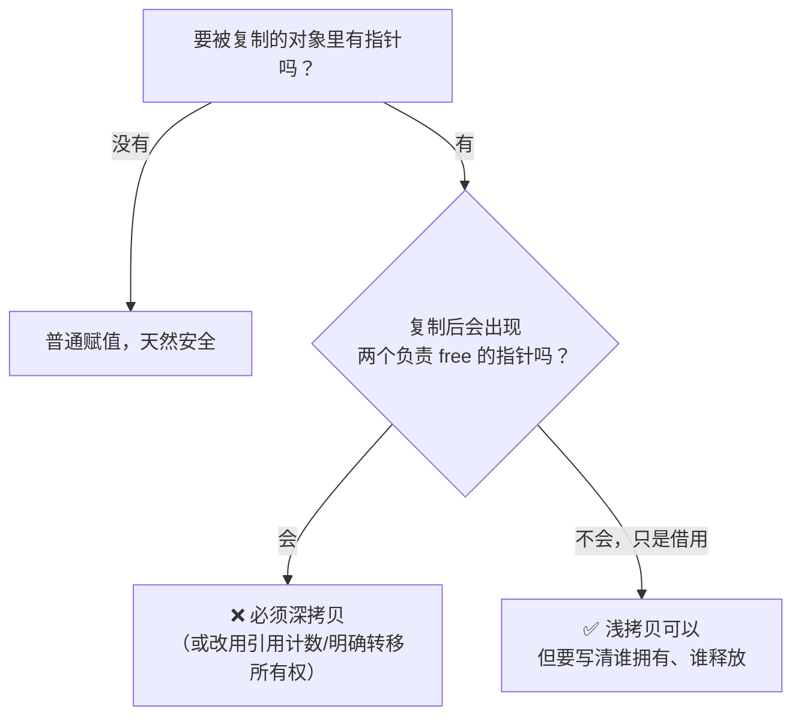

# C 语言浅拷贝笔记

> 整理日期：2026-09-17
> 适用：C 语言（C99 / C11），配套本项目 `tree/` 目录下的数据结构代码
> 一句话：**浅拷贝 = 只复制指针的「值」（地址），不复制指针「指向的内容」。**

---

## 目录

1. [核心概念](#1-核心概念)
2. [六大场景案例](#2-六大场景案例)
3. [浅拷贝的三类后果](#3-浅拷贝的三类后果)
4. [什么时候浅拷贝是「对的」](#4-什么时候浅拷贝是对的)
5. [深拷贝怎么写](#5-深拷贝怎么写)
6. [现场复现程序](#6-现场复现程序)
7. [Code Review 检查清单](#7-code-review-检查清单)
8. [排查工具](#8-排查工具)
9. [速查表](#9-速查表)

---

## 1. 核心概念

C 里没有「浅拷贝」关键字，它是**语义概念**，不是语法特性。

```
浅拷贝（shallow）                深拷贝（deep）
                                   ┌──────────┐
a ──┐                              │  "Tom"   │ ← a 自己的一份
    ├──→ ┌────────┐                └──────────┘
    │    │ "Tom"  │                ┌──────────┐
b ──┘    └────────┘                │  "Tom"   │ ← b 自己的一份
                                   └──────────┘
一块内存，两个名字                   两块内存，互不影响
（别名 aliasing）                    （各自拥有 ownership）
```

**判定法则**：只看一句话 ——

> 复制完之后，有没有出现「两个指针指向同一块 `malloc` 出来的内存」？

有 → 浅拷贝（可能有问题）。

---

## 2. 六大场景案例

### 2.1 结构体赋值 / 传参 / 返回（最常见的战场）

```c
typedef struct { char *name; int age; } Person;

Person a = { strdup("Tom"), 20 };   /* a.name 指向堆内存 */
Person b = a;                       /* ★ 浅拷贝 */

b.name[0] = 'X';      /* a.name 也变成 "Xom" —— 改一边动两边 */
free(a.name);         /* b.name 变成悬空指针 */
free(b.name);         /* ❌ double free */
```

三个同源写法，**编译器都做同样的浅拷贝**：

| 写法 | 复制了什么 |
|---|---|
| `Person b = a;` | 结构体每个字节，指针字段只复制地址 |
| `void f(Person p); f(a);` | 值传参，同上 |
| `Person b = make();` | 返回结构体，调用方拿到的也是浅拷贝 |

### 2.2 `memcpy` / `memmove`（无声的浅拷贝机器）

```c
Person b;
memcpy(&b, &a, sizeof(Person));   /* 完全等价于 b = a */
```

`memcpy` 只按**字节**搬运，完全不懂指针语义。含柔性数组的结构体也一样：

```c
typedef struct { size_t len; char data[]; } Buf;
Buf *b2 = malloc(sizeof(Buf) + n);
memcpy(b2, b1, sizeof(Buf) + n);  /* 这是深拷贝吗？—— 是！因为它连 data 一起搬了 */
```

> 注意反例：**只有当被搬的字节里包含「指针指向的内容」时，`memcpy` 才是深拷贝。**
> 结构体里放的是 `char *data` 而不是 `char data[]`，`memcpy` 就只是浅拷贝。

### 2.3 指针变量赋值 / 指针数组（最直白）

```c
int *p1 = malloc(sizeof(int) * 10);

int *p2 = p1;                     /* 浅：两个名字，一块内存 */
int *arr[3] = { p1, p1, p1 };     /* 浅：三个元素全是别名 */
int **pp = &p1;                   /* 不算拷贝，是间接层 */
```

`int *b = a;` 与 `int b = *a;` 是**完全不同的操作**：前者共享，后者取值复制。

### 2.4 字符串（新手最容易混）

```c
char s1[] = "hello";        /* 数组：自带一份内容，等价于深拷贝 */
char *s2  = "hello";        /* 指向只读字面量，不可修改 */
char s3[16];

strcpy(s3, s1);             /* ✅ 深：内容搬过去，各有一份 */
char *s4 = s1;              /* ❌ 浅：s4 和 s1 是同一块内存 */
char *tab[2] = { s1, s1 };  /* ❌ 浅：两个元素指向同一处 */
```

**关键区分**：

| 表达式 | 性质 |
|---|---|
| `strcpy(dst, src)` / `strncpy` / `memcpy(dst, src, n)` | 深（复制内容） |
| `char *p = src;` | 浅（复制地址） |
| `char p[N] = "abc";` | 深（编译器在栈上放了一份内容） |
| `char *p = "abc";` | 不拷贝，指向只读区的字面量 |

### 2.5 数组传参（隐藏得最深的共享）

```c
void f(int a[10]) { a[0] = 99; }   /* 等价于 void f(int *a) */
int arr[10] = {0};
f(arr);                            /* arr[0] 真的变成 99 */
```

数组名退化成地址，**没有任何复制发生** —— 连「浅拷贝」都算不上，纯粹是共享同一块内存。

同理：`argv`、`char **`、`void *ctx` 回调上下文、`fread`/`fwrite` 的缓冲区指针。

### 2.6 树 / 链表节点复制（本项目 `tree/` 的直接场景）

```c
Node *root = ...;      /* 已经建好的一棵树 */

Node *p = root;        /* 浅拷贝「指针」：安全，只是别名 */
Node  b = *root;       /* ★ 浅拷贝「结构体」：b.left / b.right 指向原树的孩子 */

/* 灾难现场 */
destroyTree(&b);       /* 会顺着 b.left/b.right 把整棵原树一起 free 掉 */
destroyTree(root);     /* ❌ double free / use-after-free */
```

对照表：

| 操作 | 性质 | 危险度 |
|---|---|---|
| `Node *p = root;` | 浅（拷地址） | ✅ 安全，只是别名 |
| `Node b = *root;` | 浅（结构体赋值） | ⚠️ 高，极易 double free |
| `memcpy(&b, root, sizeof(Node))` | 浅 | ⚠️ 高 |
| `cloneSubtree(root)` | **深** | ✅ 安全，各自拥有内存 |

链表里同样：`newNode->next = head;` 是**故意的浅拷贝**（借地址，不拥有），属于正常写法。

---

## 3. 浅拷贝的三类后果

### 3.1 别名修改（aliasing）

```c
b.name[0] = 'X';          /* 你以为只改了 b，其实 a 也变了 */
```

最难查的一类 bug：**修改点和使用点隔了十万八千里**。

### 3.2 Double Free（最致命）

```c
free(a.name);
free(b.name);   /* ❌ 同一块内存释放两次 */
```

后果：堆管理器元数据被破坏 → 立刻崩溃，或**在完全无关的地方**崩溃（更难定位）。

### 3.3 悬空指针 / Use-After-Free

```c
free(a.name);       /* b.name 仍然保存着那个地址 */
printf("%s", b.name);   /* ❌ 读已释放内存，可能打印垃圾或崩溃 */
```

---

## 4. 什么时候浅拷贝是「对的」

不是所有浅拷贝都是 bug，**关键看所有权（ownership）**：



**口诀**：

> **谁 `malloc`，谁 `free`。一次 `malloc` 只能有一个所有者。**
> **浅拷贝会凭空造出多个「看起来像所有者」的指针 —— 这就是所有灾难的源头。**

合理使用浅拷贝的场合：

- 只读共享数据：全局配置表、字符串字面量
- 接口句柄：`FILE *`、`SOCKET`、`sqlite3 *`
- 借用关系：链表插入 `newNode->next = head`、树的遍历传参
- 显式转移所有权（move 语义的手工版）：

```c
char *p = a.name;
a.name = NULL;      /* ★ 交出去后原主置空，保证只有一个所有者 */
free(p);
```

---

## 5. 深拷贝怎么写

C 没有自动深拷贝，**必须给每个指针字段单独分配 + 逐层递归**。

### 5.1 字符串

```c
char *copy = strdup(src);            /* POSIX，最省事 */

/* 可移植写法 */
char *copy = malloc(strlen(src) + 1);
if (copy == NULL) { /* handle */ }
strcpy(copy, src);

/* ❌ 错误示范 */
char *copy = src;                    /* 这只是浅拷贝 */
```

### 5.2 结构体

```c
Person *person_deep_copy(const Person *src) {
    Person *dst = malloc(sizeof(Person));
    if (dst == NULL) return NULL;
    dst->age  = src->age;
    dst->name = strdup(src->name);   /* ★ 指针字段单独复制内容 */
    return dst;
}
```

### 5.3 二叉树（对应本项目 `bst.c`）

```c
/* 深拷贝整棵子树：所有节点都是新内存 */
Node *cloneSubtree(const Node *n) {
    if (n == NULL) return NULL;

    Node *c = createNode(n->data);       /* 新节点 */
    c->left  = cloneSubtree(n->left);    /* 递归克隆，而不是 c->left  = n->left  */
    c->right = cloneSubtree(n->right);   /* 递归克隆，而不是 c->right = n->right */
    return c;
}
```

两边都拥有独立内存，各自 `destroyTree` 互不影响。

### 5.4 二维数组 / 指针数组

```c
/* 浅：只复制了行指针数组 */
char **rows2 = rows1;

/* 深：数组 + 每一行都要单独分配 */
char **rows2 = malloc(sizeof(char *) * n);
for (int i = 0; i < n; i++) {
    rows2[i] = malloc(strlen(rows1[i]) + 1);
    strcpy(rows2[i], rows1[i]);
}
```

---

## 6. 现场复现程序

把「改一边动两边 → double free」和「深拷贝对比」跑出来。
按本项目约定：**注释中文、输出英文**。

```c
/* shallow_copy_demo.c
 * 编译：gcc -Wall -Wextra -std=c11 -g -fsanitize=address shallow_copy_demo.c -o scdemo
 */
#include <stdio.h>
#include <stdlib.h>
#include <string.h>

typedef struct {
    char *name;
    int   age;
} Person;

static void show(const char *tag, const Person *p) {
    printf("%-6s name=%s age=%d\n", tag, p->name, p->age);
}

int main(void) {
    Person a = { strdup("Tom"), 20 };

    /* ---------- 1. 浅拷贝 ---------- */
    Person b = a;                       /* shallow: same pointer */
    show("a", &a);
    show("b", &b);
    printf("a.name == b.name ? %s\n", (a.name == b.name) ? "YES (aliased)" : "no");

    b.name[0] = 'X';                    /* alias: both change */
    show("a", &a);
    show("b", &b);

    /* ---------- 2. 深拷贝 ---------- */
    Person c = a;
    c.name = strdup(a.name);            /* deep: own copy */
    c.name[0] = 'Z';
    show("a", &a);
    show("c", &c);
    printf("a.name == c.name ? %s\n", (a.name == c.name) ? "YES" : "no (independent)");

    /* ---------- 3. 释放 ---------- */
    printf("freeing a.name then b.name would double-free\n");
    free(a.name);
    free(c.name);
    /* free(b.name);  <-- 解开注释并在 ASan 下运行，观察 double-free 报告 */

    return 0;
}
```

---

## 7. Code Review 检查清单

复制 / 赋值 / 传参时逐条过：

- [ ] 被复制的东西里有指针字段吗？（结构体、数组、字符串）
- [ ] 这些指针**指向的是什么**？堆内存？栈内存？字面量？其他对象的内部？
- [ ] 复制后有几个指针「认为自己拥有」这块内存？
- [ ] 每一个 `malloc` 是否只有**一个** `free` 与之配对？
- [ ] 函数返回结构体（或含指针的结构体）时，接收方是否知道该不该 `free`？
- [ ] 函数参数是 `const T *` 吗？加 `const` 能挡住一部分误改。
- [ ] 交接所有权后，原指针是否**置 NULL**（防止再次 free）？

> 一句话总结检查方法：**数一数有几个 `free` 可能落到同一块内存上，超过 1 就是 bug。**

---

## 8. 排查工具

| 工具 | 平台 | 能抓什么 |
|---|---|---|
| `gcc -g -fsanitize=address`（ASan） | Linux / WSL / clang | double-free、use-after-free、越界，**报第一次 free 的调用栈** |
| `valgrind --leak-check=full` | Linux / WSL | 泄漏、非法读写、double free |
| Dr. Memory | Windows | ASan 的 Windows 替代 |
| MSVC `_CrtSetDbgFlag` / `_CrtDumpMemoryLeaks()` | Windows / MSVC | 泄漏检测与堆破坏 |
| `gcc -Wall -Wextra -Wshadow` | 全平台 | 编译期零成本的粗筛（抓不到浅拷贝，但要保证零警告） |

MinGW-w64 的 GCC 通常**不支持** `-fsanitize=address`，Windows 上想去用 WSL，或直接装 MSVC / clang。

---

## 9. 速查表

| 写法 | 拷贝深度 | 内存关系 | 备注 |
|---|---|---|---|
| `int b = a;` | 值复制 | 无关 | 基本类型天然安全 |
| `int *b = a;` | **浅** | 共享 | 两个名字一块内存 |
| `int b = *a;` | 深（取内容） | 无关 | 复制的是 `int` 本身 |
| `Person b = a;` | **浅** | 指针字段共享 | 含指针结构体的赋值 |
| `memcpy(&b, &a, sizeof a)` | **浅** | 指针字段共享 | 除非结尾是柔性数组 |
| `char *b = "abc";` | 不拷贝 | 指向只读区 | 不可写 |
| `char b[] = "abc";` | 深 | 栈上一份 | 可写 |
| `strcpy(b, a)` | 深 | 各一份 | 注意 `b` 容量 |
| `strdup(a)` | 深 | 堆上一份 | 记得 free |
| `char *tab[] = {a, a};` | **浅** | 共享 | 指针数组 |
| `Node b = *root;` | **浅** | 孩子指针共享 | ⚠️ 树/链表高危 |
| `cloneSubtree(root)` | 深 | 全新节点 | 需手写递归 |
| `newNode->next = head;` | **浅** | 借用地址 | ✅ 链表正常写法 |

---

## 附：与本项目 `tree/` 代码的对照

| 文件 | 相关点 |
|---|---|
| `bst.c` | `Node *root = NULL; root = insert(...)` 系列都是「指针赋值」，**安全**（只借用地址，唯一所有者还是 `root`） |
| `bst.c` | `destroyTree` 是递归 `free`，一旦有人 `Node copy = *root;` 就会 double free |
| `bst.c` | 若要「复制一棵树」，必须照 §5.3 写 `cloneSubtree`，不能 `Node *p = root;` 了事 |
| `bst.c` / `Btree.c` | `return createNode(data);` 返回堆地址 —— 所有权**转移**给调用方，是标准做法 |
| `Btree.c` | 分裂时把 `child[i]` 交给新节点，是**指针搬迁**（不是拷贝），所有权随之转移，注意别两边都 free |

**核心一句话收尾**：

> **浅拷贝本身不是错误，忘记它有多个所有者才是错误。**
